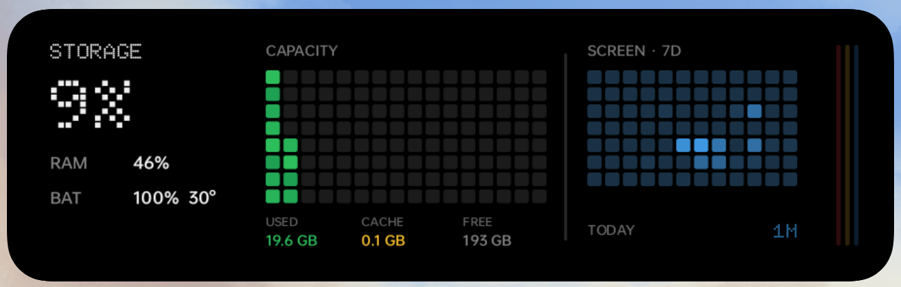

# Nothing Storage Status Widget

面向 OnePlus 7T Pro / ColorOS 的 Nothing 风格 3×1 原生 Android 桌面组件。



## 功能

- 容量热力图：绿色为普通占用，黄色为真实系统缓存，暗格为可用空间。
- 屏幕使用热力图：最近7天 × 每天12个两小时时段，蓝色亮度表示真实亮屏时长。
- 左侧显示存储占比、RAM、电量与电池温度。
- 右侧状态线提示存储压力、高温、低电量或充电。
- 点击播放约1.45秒的单条斜线自检动画，结束后不再持续刷新。
- 无网络依赖；纯Java、`AppWidgetProvider + RemoteViews + Canvas`。

## 权限

屏幕时间与系统缓存使用 Android 的“使用情况访问”特殊权限。权限不可用时显示明确的不可用状态，不生成演示数据。缓存查询失败时可在 Magisk 设备上尝试只读Root降级，并具有超时限制。

## 构建

项目使用轻量Android工具链，默认复用Unity附带的SDK/JDK：

```sh
./build.sh
```

输出位于 `build/storage-status.apk`。调试签名和构建产物不会提交到仓库。

设计与实机验证记录见 [PROJECT_NOTES.md](PROJECT_NOTES.md)。Doto字体遵循其随附的OFL许可证。
